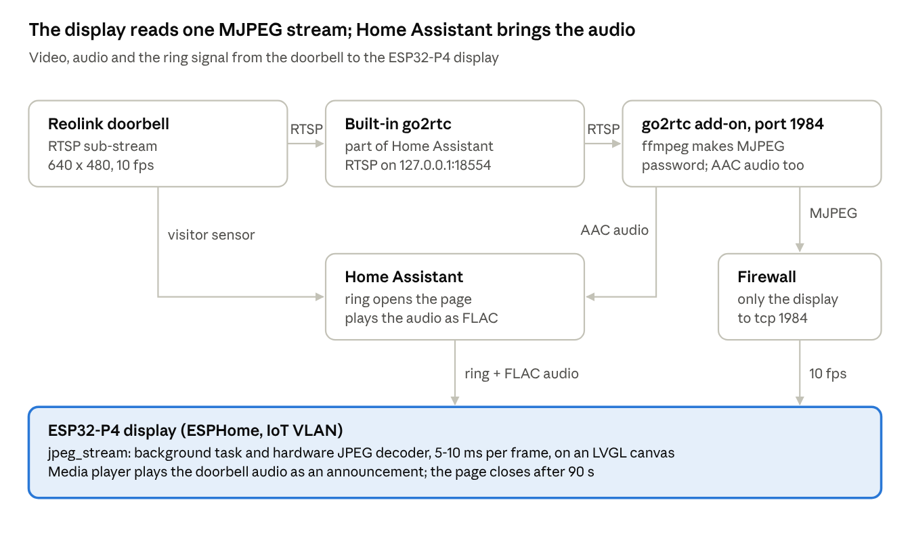

# Live Reolink doorbell video and audio on an ESP32-P4 display

11 October 2026, updated 10 November 2026 · Martijn Buts

## What you build

When someone rings the doorbell, an ESP32-P4 display opens a page with the live picture of the Reolink doorbell: 10 frames per second, under 1 s delay. At the same time the doorbell audio plays on the display's speaker. A video button shows the picture without a ring as well. From the IoT VLAN the display only needs port 1984 of go2rtc and the Home Assistant URL it already uses; the camera stays closed to it.



The display opens one MJPEG connection to go2rtc; Home Assistant sends the ring and plays the audio.

Written for: a Reolink D340P (any Reolink with an RTSP sub-stream in Home Assistant works), a Waveshare display with an ESP32-P4 and PSRAM (1024×600, LVGL), Home Assistant OS 2026.10.1 with the go2rtc add-on 1.9.14 (now running on 2026.11.1 and 1.9.15), ESPHome 2026.11.0-dev (versions checked again on 10 November 2026) and a MikroTik router as the firewall example. All code is in the repository [martijnbuts/esphome-p4-doorbell](https://github.com/martijnbuts/esphome-p4-doorbell).

## What you need

You need a Reolink camera in Home Assistant, the go2rtc add-on and an ESP32-P4 display that runs ESPHome with LVGL.

| Part | Requirement | Why |
| --- | --- | --- |
| Reolink doorbell or camera | Added with the Reolink integration; a sub-stream of 640×480 | Home Assistant's built-in go2rtc serves its RTSP stream on 127.0.0.1:18554 |
| Home Assistant | HA OS or Supervised (add-ons); tested on 2026.10.1, runs on 2026.11.1 | Runs the go2rtc add-on and converts the audio for the display |
| go2rtc add-on | From the AlexxIT add-on repository; tested on 1.9.14, runs on 1.9.15 | Turns the RTSP stream into MJPEG and AAC, behind a password |
| ESP32-P4 board with display | PSRAM (the frame buffers take about 1.5 MB), Wi-Fi, LVGL; the board in ESPHome must match the chip revision (below v3.0: esp32-p4-evboard, v3.0 and newer: esp32-p4\_r3-evboard) | The P4 has a hardware JPEG decoder: 5–10 ms per frame |
| ESPHome | 2026.11.0 or newer (now beta 2026.11.0b3 or dev) with ESP-IDF 5.5, 6.0 or 6.1 (all three tested) | The components use the LVGL 9 canvas and the ESP-IDF JPEG driver; LVGL only draws with the PPA from ESP-IDF 6.0 |
| Media player on the display | An ESPHome `speaker` media player with an announcement pipeline | The doorbell audio plays as an announcement and pauses music |
| Router | Firewall rules between VLANs (the example is MikroTik RouterOS 7) | The display sits in an IoT VLAN and may only reach go2rtc |

Replace the values between `< >` with your own: `<ha-ip>`, `<display-ip>`, `<go2rtc-password>`, `<stream-name>`, `<camera-entity>`, `<doorbell-sensor>` and `<display-media-player>`. Make a Home Assistant backup and an export of your router configuration before you start.

## Step 1: Set up go2rtc

This step makes an MJPEG stream of the doorbell that the display can read. The go2rtc add-on takes the RTSP stream from Home Assistant's built-in go2rtc and lets ffmpeg turn it into MJPEG. Only the API port gets a password; Home Assistant itself (127.0.0.1) needs none.

1. Turn on *Preload stream* for the camera: *Settings → Devices & services → Entities*, open `<camera-entity>`, click the gear icon, switch on **Preload camera stream**. Home Assistant only offers the stream on 127.0.0.1:18554 while it is loaded.
2. Find the stream name. Home Assistant names it `<platform>_<unique_id>`. Run this in the *Terminal & SSH* add-on:

   ```bash
   jq -r '.data.entities[] | select(.entity_id=="<camera-entity>") | "\(.platform)_\(.unique_id)"' /config/.storage/core.entity_registry
   ```

   For a Reolink sub-stream you get something like `reolink_<serial>_0_sub`. That is your `<stream-name>`.
3. Add the add-on repository: *Settings → Add-ons → Add-on store → ⋮ → Repositories*, paste `https://github.com/AlexxIT/hassio-addons` and click **Add**. Install **go2rtc** and turn on **Start on boot** and **Watchdog**.
4. Create `/config/go2rtc.yaml` (the add-on reads it from there) with this content:

   ```yaml
   api:
     listen: ":1984"
     username: p4display
     password: "<go2rtc-password>"
   rtsp:
     listen: "127.0.0.1:8554"   # only for ffmpeg inside go2rtc
   exec:
     allow_paths:
       - ffmpeg
   streams:
     doorbell: rtsp://127.0.0.1:18554/<stream-name>
     doorbell_mjpeg: ffmpeg:doorbell#video=mjpeg
   preload:
     doorbell_mjpeg: video      # keep the MJPEG conversion running: first frame in 0.1 s instead of 8 s
   log:
     level: info
   ```

   The `preload` keeps ffmpeg running all the time. Without it, ffmpeg only starts when the display opens the page, and the first frame takes about 8 s (ffmpeg start and the next key frame of the camera). On the tested Home Assistant host the go2rtc add-on then used about 0.5 % CPU with the page closed; leave it out if that matters more to you.
5. Restart the add-on and open its *Log* tab. You should see `[api] listen addr=:1984` and no errors.

Control: from a computer in your LAN, run

```bash
curl -u p4display:<go2rtc-password> -o frame.jpg "http://<ha-ip>:1984/api/frame.jpeg?src=doorbell_mjpeg"
```

You should get a JPEG of the doorbell. The same command without `-u` must give `Unauthorized`.

The go2rtc web page in Home Assistant now asks for this user name and password too.

## Step 2: Open port 1984 for the display only

This step lets the display, and nothing else from the IoT VLAN, reach go2rtc. Give the display a static DHCP lease first, so `<display-ip>` never changes.

1. Open a terminal on the MikroTik (WinBox *New Terminal* or SSH).
2. Paste this. It adds the rule only once, so you can run it again safely:

   ```
   /ip firewall filter
   :if ([:len [find comment="P4 display to go2rtc"]] = 0) do={
     add chain=forward action=accept protocol=tcp src-address=<display-ip> \
       dst-address=<ha-ip> dst-port=1984 comment="P4 display to go2rtc"
   }
   ```
3. Move the rule above the rule that drops traffic from the IoT VLAN: in WinBox drag it up in *IP → Firewall → Filter Rules*, or run

   ```
   /ip firewall filter move [find comment="P4 display to go2rtc"] destination=[find comment="<your-iot-drop-rule>"]
   ```

The order matters: RouterOS stops at the first rule that matches. Below a drop rule this rule never gets a packet.

The display also needs the Home Assistant URL that it already uses for text-to-speech. Home Assistant serves the doorbell audio from there (Step 5).

Control: run `/ip firewall filter print stats where comment="P4 display to go2rtc"`. After Step 4 the packet counter goes up while the doorbell page is open.

## Step 3: Add the jpeg\_stream component

This step adds the component that shows the stream. It receives the frames in a background task and decodes them with the hardware JPEG decoder of the ESP32-P4. The main loop only swaps the canvas buffer, so touch and a wake word keep working.

1. Add this to the device configuration in ESPHome:

   ```yaml
   external_components:
     - source: github://martijnbuts/esphome-p4-doorbell@main
       components: [jpeg_stream]
   ```
2. Make sure the device has `psram:` and an `lvgl:` section. The component checks that the chip is an ESP32-P4.

The component reads two kinds of URL. It looks at the `Content-Type` of the answer:

| URL gives | What the component does | Example |
| --- | --- | --- |
| `multipart/x-mixed-replace` (MJPEG) | Keeps one connection open; every part is a frame. Each part needs a `Content-Length` header. | `http://user:pass@<ha-ip>:1984/api/stream.mjpeg?src=doorbell_mjpeg` |
| `image/jpeg` (one picture) | Fetches the picture again and again over one kept-alive connection | The camera proxy of Home Assistant |

A user name and password in the URL are sent as HTTP Basic authentication. A frame that arrives while the previous one is not on the screen yet is skipped, which keeps the delay low.

| Option | Default | Meaning |
| --- | --- | --- |
| `canvas` | required | The LVGL canvas to draw on; the component gives it its own buffers and size |
| `url` | none | Start URL; usually set with `jpeg_stream.start` |
| `max_width`, `max_height` | 640, 480 | Largest picture; sets the size of the two frame buffers in PSRAM |
| `max_jpeg_size` | 262144 | Largest JPEG in bytes |
| `timeout` | 5s | Network timeout; use 10s for go2rtc, which waits for a key frame |
| `min_interval` | 0ms | Minimum time between two frames |
| `on_frame`, `on_error` | none | Automations after each frame and after each error |

Actions: `jpeg_stream.start` (with an optional `url`), `jpeg_stream.stop` and `jpeg_stream.set_url`. Condition: `jpeg_stream.is_running`. In a lambda, `get_last_frame_time()` gives the decode time of the last frame, `get_dropped_count()` the skipped frames and `get_last_shown()` the `millis()` of the last frame on the canvas. When a stream starts, the log shows `First frame ... ms after start`. The option `stats_interval` (default `0s`, off) logs where the time goes; see *Performance*.

## Step 4: Add the doorbell page

This step adds the page that opens on a ring, as a package from the repository. It brings the page, the scripts, the fallback to Home Assistant snapshots and a button *Open doorbell camera* in Home Assistant.

Do you have the Waveshare ESP32-P4-WIFI6-Touch-LCD-7B? Then start from the complete example `example/waveshare-p4-7b.yaml` in the repository. It has the display, touch, Wi-Fi, the speaker and a home page with a video button. It compiles with ESPHome 2026.11.0-dev and validates with 2026.11.0b3 and 2026.12.0-dev (10 November 2026); its doorbell part is an English copy of the configuration that runs on the tested display. Otherwise add the package to your own configuration:

1. Put the go2rtc password in `secrets.yaml` of ESPHome:

   ```yaml
   go2rtc_password: "<go2rtc-password>"
   ```

   Use only letters and digits: the password goes into a URL.
2. Add the package to the device configuration:

   ```yaml
   packages:
     doorbell:
       url: https://github.com/martijnbuts/esphome-p4-doorbell
       ref: main
       files:
         - path: example/doorbell.yaml
           vars:
             doorbell_sensor: <doorbell-sensor>
             camera_entity: <camera-entity>
             ha_url: <ha-url>
             go2rtc_url: http://<ha-ip>:1984
             go2rtc_user: p4display
             go2rtc_password: !secret go2rtc_password
             go2rtc_stream: doorbell_mjpeg
             go2rtc_audio: doorbell
             media_player_id: <media-player-id>
             display_media_player: <display-media-player>
             time_id: <time-id>
             home_page: <home-page-id>
             close_after: 90s
   ```

   `<doorbell-sensor>` is the binary sensor that turns on at a ring (for a Reolink: *Visitor*). `<ha-url>` is the Home Assistant URL that the display can reach, without a trailing `/`. `<media-player-id>` and `<time-id>` are ESPHome ids in your configuration; `<display-media-player>` is that media player as an entity in Home Assistant.
3. Add a video button to your own page. It opens the page without a ring:

   ```yaml
   - button:
       width: 56
       height: 44
       on_click:
         - script.execute: doorbell_live
   ```
4. In ESPHome click **Validate**, then **Install → Wirelessly**.

The page uses two LVGL frame buffers of 640×480 in PSRAM (about 1.2 MB) and a JPEG buffer of 256 KB. They are made the first time the page opens and stay for the next time.

Optional: does your doorbell have a person (or motion) sensor in Home Assistant? Then add `example/prewarm.yaml` as a second file of the package, with the vars `presence_sensor: <presence-sensor>` and `prewarm_hold: 30s` (the complete example shows how). It starts the stream invisibly when the sensor turns on, so the picture is there at once when someone rings, and stops it 30 s after the sensor turned off. Do the go2rtc `preload` from Step 1 first: a person sensor usually fires only 1–3 s before the ring. The package also adds a button Prewarm doorbell stream in Home Assistant that does the same for 30 s: handy to test, or for an automation (for example when the garden gate opens).

Control: press **Open doorbell camera** in Home Assistant and open the logs of the device. Every 5 s you should see a line like `go2rtc: 50 frames in 5 s, last frame 6 ms, 0 skipped`.

## Step 5: Turn on the doorbell audio

This step lets Home Assistant play the doorbell audio on the display. When the page opens, the display asks Home Assistant to play `http://127.0.0.1:1984/api/stream.aac?src=doorbell` as an announcement. Home Assistant fetches it from go2rtc on its own host (no password needed from 127.0.0.1), converts it to FLAC and streams it to the display. Music on the display pauses meanwhile.

1. Allow the display to call Home Assistant actions: *Settings → Devices & services → ESPHome*, click **Configure** next to the display and switch on **Allow the device to perform Home Assistant actions**.
2. Make sure the media player of the display has an `announcement_pipeline` (the complete example has one):

   ```yaml
   media_player:
     - platform: speaker
       id: display_media_player
       name: "Media Player"
       announcement_pipeline:
         speaker: board_speaker
         format: FLAC
         sample_rate: 48000
         num_channels: 1
   ```
3. The package stops the audio itself when the page closes, with `media_player.stop` and `announcement: true`. The Stop button in Home Assistant does not stop an announcement.

The audio is 1–2 s behind the picture, because ffmpeg and the media player buffer it.

Control: open the page and look at the media player in Home Assistant. It should say *Playing* within a second, and you hear the street. After **Back** it goes to *Idle*.

## Optional: talk back through the doorbell

This step adds a **Talk** button to the doorbell page: tap it and the display's microphone plays on the doorbell's speaker, tap again to stop. Built and installed on 10 November 2026; **not yet tested with sound at the door**, so the codec and the volume are still open (see the end of this section).

How it works: the `go2rtc_talkback` component serves the microphone as a WAV on its own port, only to the go2rtc host, and asks go2rtc to play it on the doorbell (`POST /api/ffmpeg?dst=doorbell_talk&live=http://<display-ip>:8555/talk.wav`). go2rtc's ffmpeg converts it to the codec the doorbell asks for (a Reolink backchannel takes only G.711: PCMU or PCMA) and sends it over the RTSP backchannel. Home Assistant 2026.11 does the same in the browser (Labs: *Two-way audio*).

1. Check that the doorbell can receive audio: *Settings → Devices & services → Reolink*, **Download diagnostics**, and look for `two_way_audio` under `capabilities` (the D340P with firmware v3.0.0.6460 has it).
2. Add a go2rtc stream only for talking, straight to the doorbell, in `/config/go2rtc.yaml`, and restart the add-on:

   ```yaml
   streams:
     doorbell_talk: rtsp://<camera-user>:<camera-password>@<doorbell-ip>:554/h264Preview_01_sub
   ```

   go2rtc opens this stream only while you talk and closes it 1 s after you stop, so the doorbell's backchannel is free again. Don't add `?backchannel=1` to the `doorbell` stream instead: that stream is always on (preload), go2rtc reconnects a camera session when a backchannel joins (the picture stalls for everyone), and an open backchannel keeps a Reolink in two-way mode, with the ring light blue and the chime silent ([go2rtc#1860](https://github.com/AlexxIT/go2rtc/issues/1860)). This stream needs the camera password in the add-on; it stays behind the go2rtc login.
3. Let go2rtc reach the display on tcp 8555, the other way round from Step 2. MikroTik, run once, then move the rule above the IoT drop rule as in Step 2:

   ```
   /ip firewall filter
   :if ([:len [find comment="go2rtc to P4 display microphone"]] = 0) do={
     add chain=forward action=accept protocol=tcp src-address=<ha-ip> \
       dst-address=<display-ip> dst-port=8555 comment="go2rtc to P4 display microphone"
   }
   ```
4. Give the display a microphone. The Waveshare 7B has an ES7210 with two microphones; `example/waveshare-p4-7b.yaml` has the `audio_adc` and `microphone` blocks.
5. Add the package next to `doorbell.yaml`, with `go2rtc_talkback` in `external_components`:

   ```yaml
   external_components:
     - source: github://martijnbuts/esphome-p4-doorbell@main
       components: [jpeg_stream, go2rtc_talkback]

   packages:
     doorbell:
       url: https://github.com/martijnbuts/esphome-p4-doorbell
       ref: main
       files:
         - path: example/doorbell.yaml
           vars: { ... }                               # as in Step 4
         - path: example/talkback.yaml
           vars:
             microphone_id: board_microphone
             mic_channel: "0"
             mic_gain: "4"
             go2rtc_url: http://<ha-ip>:1984
             go2rtc_host: <ha-ip>
             go2rtc_user: p4display
             go2rtc_password: !secret go2rtc_password
             go2rtc_audio: doorbell
             go2rtc_talk: doorbell_talk
             talk_port: "8555"
             talk_max: 120s
             media_player_id: display_media_player
             display_media_player: <display-media-player>
   ```

While you talk, the doorbell audio on the display stops, otherwise the doorbell hears itself (feedback); it comes back when you stop. Talking stops by itself after `talk_max`, and when the page closes. The button floats over the page just above **Back**, so `doorbell.yaml` needs no change.

| `go2rtc_talkback` option | Default | What it does |
| --- | --- | --- |
| `microphone` | required | Microphone source: `microphone`, `channels` (one), `gain_factor` (1–64) |
| `url` | required | go2rtc API, `http://<ha-ip>:1984` |
| `username`, `password` | none | go2rtc API login |
| `stream` | required | go2rtc stream to play on; its camera must accept two-way audio |
| `port` | `8555` | Port on the display where go2rtc's ffmpeg fetches the microphone (`/talk.wav`) |
| `allowed_ips` | everyone | Who may fetch the microphone; set the go2rtc host |
| `max_duration` | `60s` | Stop by itself after this time |
| `on_streaming`, `on_stop`, `on_error` | none | go2rtc fetches the microphone; talking stopped (any reason); go2rtc refused or closed the stream (after `on_stop`) |

Actions `go2rtc_talkback.start` and `go2rtc_talkback.stop`; conditions `go2rtc_talkback.is_active` and `go2rtc_talkback.is_streaming`. The microphone is shared: a wake word on the same microphone keeps working, but stop it while talking, or a wake word in a sentence starts the voice assistant (the comment at the top of `talkback.yaml` shows how).

Control: tap **Talk**. The button turns red and says *Stop talking* within about a second; the log shows `go2rtc is fetching the microphone (... ms after start)`. Speak and listen at the door. Tap again: the log shows `Stopped after ... ms: ... bytes sent`. Then ring the doorbell: the chime must sound and the ring light must not stay blue.

The backchannel codec of the D340P (firmware v3.0.0.6460) is PCMU/8000; go2rtc picks it with `#audio=auto`. You can check yours without sound: `http://<ha-ip>:1984/api/streams?src=doorbell_talk&video=all&audio=all` (with the go2rtc login) lists it as `audio, sendonly, PCMU/8000`.

Still open (10 November 2026): the delay (others report 1–2 s with Reolink, also from the browser), and the volume (`mic_gain`, and *Speak volume* of the doorbell in the Reolink integration).

## Optional: screenshot of the display

This step adds a camera entity to Home Assistant that shows what the display shows. It is handy to check the doorbell page or a dashboard from a distance, and for documentation. The `lvgl_screenshot` component has nothing to do with the camera snapshots of the fallback: those come *from* Home Assistant, this picture goes *to* Home Assistant.

1. Add the component next to `jpeg_stream`:

   ```yaml
   external_components:
     - source: github://martijnbuts/esphome-p4-doorbell@main
       components: [jpeg_stream, lvgl_screenshot]

   lvgl_screenshot:
     name: "Screen"
     jpeg_quality: 85      # ESP32-P4 only; leave it out on other chips
   ```
2. Install the firmware. Home Assistant adds `camera.<device>_screen` to the device by itself.

How it works: when Home Assistant asks for a picture, the component renders the active LVGL screen once more with `lv_snapshot` (RGB565) and encodes it to JPEG. The picture goes over the encrypted ESPHome API like that of any ESPHome camera. When nobody asks, nothing happens and no memory is used.

Which JPEG encoder:

| Chip | Encoder | Where it runs |
| --- | --- | --- |
| ESP32-P4 | Hardware JPEG encoder (`esp_driver_jpeg`), a few ms | Main loop |
| ESP32-S3 and other ESP32s | Software JPEG from ESPHome's [`camera_encoder`](https://esphome.io/components/camera/camera_encoder/) (esp32-camera), loaded automatically | Its own FreeRTOS task, so the main loop and the display keep running while it encodes |
| Any chip with `encoder:` set | The `camera_encoder` you name | Its own task |

The configuration is the same on every chip. On an S3 you can set the software encoder's quality with a `camera_encoder:` block; it is picked up automatically:

```yaml
camera_encoder:
  quality: 85              # 1–100, default 80
  buffer_size: 131072      # optional: start size of the JPEG buffer; it grows when needed

lvgl_screenshot:
  name: "Screen"
```

| Option | Default | What it does |
| --- | --- | --- |
| `name`, `id`, `icon`, `internal`, … | | The usual entity options |
| `jpeg_quality` | `85` | ESP32-P4 hardware encoder only: JPEG quality, 10–100. The encoder uses 4:4:4, so small coloured text stays sharp. On other chips set `quality` under `camera_encoder:` (using `jpeg_quality` there is an error) |
| `stream_interval` | `1s` | Time between pictures while the live view of the camera is open in Home Assistant |
| `encoder` | | ID of a `camera_encoder` to use instead of the hardware encoder (also on the P4) |
| `task_priority` | `1` | Software encoder only: FreeRTOS priority of the encoding task. 1 is the same as the main loop; on a dual-core chip the task then mostly runs on the other core |

Points to know:

- **Any ESP32 with LVGL**: the component turns on `LV_USE_SNAPSHOT` (off in the `lv_conf.h` ESPHome generates). On the P4 it also adds the ESP-IDF `esp_driver_jpeg` component; on other chips `camera_encoder` adds Espressif's `esp32-camera` library (only its JPEG code is used).
- **Memory**: the first picture allocates the raw screen buffer, which stays: width × height × 2 (1.2 MB at 1024×600, 750 KB at 800×480). It goes in PSRAM when there is PSRAM, otherwise in internal RAM, which only fits small screens. The P4 also keeps a JPEG output buffer of half that size; the software encoder keeps its output buffer (starts at a quarter of the raw size and grows when needed). Every picture gets its own copy of the exact JPEG size while it is sent. A 1024×600 dashboard at quality 85 was 111 KB on the P4 (measured 10 November 2026).
- **Only the active screen**: widgets on LVGL's top or system layer (for example a message box shown on `lv_layer_top`) are not in the picture. The picture is the LVGL screen itself, not a read-back of the panel.
- **P4: the screen size must be a multiple of 8** in both directions (1024×600 is). Otherwise the log says `Screen size ... is not a multiple of 8` and no picture is made. The software encoder has no such limit.
- **Time**: rendering always happens in the main loop (LVGL is not thread-safe). On the P4 the hardware encode does too (a few ms). The software encode runs in its own task and takes longer (expect a few hundred ms for 800×480 on an S3, still to be measured). The log shows both times (`Screenshot 800x480, ... bytes (render ... ms, jpeg ... ms)`; the first after boot at INFO, the rest at DEBUG). Keep `stream_interval` at 1 s or more.
- **P4: shares the JPEG engine with `jpeg_stream`**: the ESP-IDF driver lets only one of them use the engine at a time, so a screenshot waits until a doorbell frame is decoded (a few ms). Both use DMA2D; see *DMA2D: JPEG decoder and PPA* in [PERFORMANCE.md](PERFORMANCE.md#dma2d-jpeg-decoder-and-ppa).
- **Privacy**: everyone who can see the camera entity in Home Assistant sees the screen, including the doorbell picture while the page is open.

Control: open the camera entity in Home Assistant. You see the current screen, and the log of the display shows `First screenshot 1024x600, ... bytes`.

## Performance

On the tested display a frame takes about 2–3.5 ms to receive and 3.5 ms to decode. The limit is the LVGL refresh of the 640×480 picture on the main loop. The camera delivers 10 fps, so every camera frame is shown in all set-ups below. With the synthetic source the display now shows up to 39 fps, against 21.5 fps before.

Measured on 12 October 2026 on the Waveshare ESP32-P4-WIFI6-Touch-LCD-7B (360 MHz, `buffer_size: 100%`) with ESPHome 2026.11.0-dev. The synthetic source is an ffmpeg test picture of 640×480 from go2rtc.

| Set-up | Input | Shown | LVGL refresh (of which flush) |
| --- | --- | --- | --- |
| `rotation: 180`, with `clip_corner` | Camera, 10 fps | 10.0 fps | 51.5 ms (17.4 ms) |
| `rotation: 180` | Camera, 10 fps | 10.0 fps | 41.3 ms (17.4 ms) |
| `rotation: 180` | Synthetic, 30 fps | 21.5 fps (29 % skipped) | 45.7 ms (19.5 ms) |
| No rotation | Camera, 10 fps | 10.0 fps | 28.0 ms (4.6 ms) |
| No rotation, ESP-IDF 6.0, `LV_USE_PPA_IMG` | Camera, 10 fps | 10.0 fps | 20.8 ms (4.2 ms) |
| No rotation, ESP-IDF 6.0, `LV_USE_PPA_IMG` | Synthetic, 30 fps | 29.9 fps (0.1 % skipped) | 22.2 ms (4.8 ms) |
| No rotation, ESP-IDF 6.0, `LV_USE_PPA_IMG` | Synthetic, 60 fps | 38.8 fps (35 % skipped) | 23.2 ms (4.6 ms) |

What made the difference:

- **No `clip_corner`** (rounded corners) on the card around the picture: about 10 ms per frame. The package no longer uses it.
- **No LVGL rotation**: `rotation: 180` turned every refresh with the PPA into an extra 1.2 MB buffer: 13 ms per frame. If your display hangs upside down, turn the display around instead and remove the rotation; touch follows by itself.
- **ESP-IDF 6.x and LVGL drawing the picture with the PPA**: 8 ms per frame. With ESP-IDF 6.0 or newer (`esp32: framework: version: 6.1.0`; measured with 6.0.1) ESPHome turns on the LVGL PPA draw unit for fills; drawing images with it is a separate LVGL option. Add it as a build flag: `esphome: build_flags: [-DLV_USE_PPA_IMG=1]`.

One known risk on the ESP32-P4: the hardware JPEG decoder and the PPA share the 2D-DMA controller, which can hang under load ([esp-idf#19108](https://github.com/espressif/esp-idf/issues/19108), still open on 10 November 2026). With `LV_USE_PPA_IMG` both run for every frame. On ESPHome's default ESP-IDF 5.5 LVGL does not draw with the PPA at all, so the decoder only meets the PPA when LVGL has a `rotation`. PERFORMANCE.md describes it and two ways to keep them apart.

The start-up is set by go2rtc, not by the display: 7.7 s from opening the page to the first frame without `preload`, 0.13 s with it.

To measure on your own display:

1. Add `stats_interval: 10s` to `jpeg_stream`. While the page is open the log shows every 10 s:

   ```
   Stats over 10.0 s: 10.0 fps shown (100 shown, 100 received, 0 skipped, 0 errors)
     JPEG size: avg 21.7 KB, 217 KB/s
     Receive:   avg 3.4 ms, max 10.0 ms
     Decode:    avg 3.6 ms, max 6.0 ms
     Hand-off:  avg 3.1 ms, max 30.4 ms (task -> canvas in the main loop)
     Frame gap: max 155.4 ms
     LVGL refresh: 102 x, avg 51.6 ms, max 58.2 ms (layout + render + flush)
     LVGL flush:   avg 17.4 ms per refresh (flush_cb: copy to the display)
   ```
2. The start-up time is in the log when the page opens: `First frame ... ms after opening the page`.
3. For the time per component in the main loop and the CPU load per task, add the package `example/measure.yaml` from the repository. Remove it after measuring.
4. To find the ceiling, let go2rtc send a test picture instead of the camera, and restart the add-on:

   ```yaml
   streams:
     doorbell_mjpeg: "exec:ffmpeg -hide_banner -v error -re -f lavfi -i testsrc2=size=640x480:rate=30 -c:v mjpeg -q:v 8 -f mjpeg -"
   ```
5. Leave out the 10-second windows in which `runtime_stats` prints its report: that burst stalls the main loop for about 0.5 s.

[docs/PERFORMANCE.md](https://github.com/martijnbuts/esphome-p4-doorbell/blob/main/docs/PERFORMANCE.md) has all measurements, the CPU load per task and the ideas that are left: drawing the video outside LVGL with the PPA, and double draw buffers.

## Testing

Test each part on its own, from the network the display is in, before you rely on a real ring.

| Test | How | Good if |
| --- | --- | --- |
| go2rtc gives a picture | `curl -u p4display:<go2rtc-password> -o frame.jpg "http://<ha-ip>:1984/api/frame.jpeg?src=doorbell_mjpeg"` | `frame.jpg` shows the doorbell |
| go2rtc is closed without a password | The same command without `-u` | `Unauthorized` |
| Only the display reaches port 1984 | The `curl` command from another device in the IoT VLAN | Time-out |
| Picture on the display | Press **Open doorbell camera** in Home Assistant | The picture is there within 0.5 s (log: First frame ... ms after opening the page); the log shows about 50 frames per 5 s |
| Low delay | Compare the clock in the camera picture with a clock next to you | Less than 1 s behind |
| Audio | Open the page and watch the media player in Home Assistant | *Playing* within 1 s; you hear the street |
| Audio stops | Press **Back** | Media player *Idle*; no consumers left in go2rtc (`/api/streams`) |
| Fallback | Stop the go2rtc add-on and open the page | After about 2 s the status says `(via HA)` at 3–4 fps |
| Real ring | Ring the doorbell | The page opens by itself and closes after 90 s |
| Talk back (optional) | Open the page, tap **Talk**, speak | You hear yourself at the door; the button is red with *Stop talking*; the log shows `go2rtc is fetching the microphone` |
| Screenshot (optional) | Open `camera.<device>_screen` in Home Assistant | The picture matches the display; the log shows `First screenshot ...` |

Start the go2rtc add-on again after the fallback test.

## Pitfalls

These problems came up while building this.

| Problem | Cause | Solution |
| --- | --- | --- |
| 0.4 fps, touch freezes, wake word warnings | `online_image` downloads and decodes in software in the main loop (about 2.7 s per frame) | Use `jpeg_stream`: background task and hardware decoder |
| Never more than about 4 fps | Every snapshot from the Home Assistant camera proxy takes 0.25–0.3 s, and snapshots run one after the other | Read the MJPEG stream from go2rtc |
| `streams: hass: wrong response` in the go2rtc log | The `hass://` source of go2rtc does not work with current Home Assistant | Use `rtsp://127.0.0.1:18554/<stream-name>` |
| `method DESCRIBE failed: 404` in the go2rtc log | *Preload camera stream* is off, or the stream name is wrong | Turn on preload; look up the name with the `jq` command from Step 1 |
| `HTTP status 401` in the display log | Wrong user name or password, or a password with characters such as `@` or `:` | Use the same values as in `go2rtc.yaml`, letters and digits only |
| Display cannot connect to Home Assistant on port 8123 | The IoT VLAN may not reach Home Assistant | Use the URL the display already uses (for example the HTTPS URL on 443), or open the port for the display only |
| Audio keeps playing after **Stop** in Home Assistant | The Stop button does not stop an announcement on an ESPHome media player | Close the page on the display; the package stops it with `announcement: true` |
| The first frame takes several seconds | ffmpeg waits for a key frame of the camera | Keep `timeout: 10s`; add preload: doorbell\_mjpeg: video to go2rtc.yaml (Step 1) for a first frame in about 0.1 s |
| `OTA with 32MB flash requires 'enable_idf_experimental_features'` | ESPHome rule for boards with 32 MB flash | Add `enable_idf_experimental_features: true` under `esp32: framework: advanced:` |
| go2rtc web page asks for a login | The API password also protects the web page | Log in with the user name and password from `go2rtc.yaml` |
| `'active_high' is a required option for [esp32_hosted]` | ESPHome 2026.10 still needs it; 2026.11 and newer ignore it and warn that it is deprecated | On ESPHome 2026.10 add `active_high: true` under `esp32_hosted:`; on 2026.11 and newer leave it out |
| **Talk** shows *Failed* | go2rtc could not play the microphone: the talk stream is missing or its camera refuses two-way audio, or go2rtc cannot reach the display on port 8555 | The log says which (`go2rtc refused to play (HTTP ...)`, `not reachable` or `closed the microphone stream`); check Step 2 and 3 of *Talk back* |
| Ring light stays blue, the chime is silent | A backchannel is still open, e.g. `?backchannel=1` on an always-on stream ([go2rtc#1860](https://github.com/AlexxIT/go2rtc/issues/1860)) | Talk only through the separate `doorbell_talk` stream; restart the go2rtc add-on to free it |
| A whistle while talking | The doorbell hears its own speaker through the display | The package stops the doorbell audio while you talk; lower `mic_gain` or the doorbell's speaker volume |

Don't need audio or more than 4 fps? Then the snapshot mode alone (`jpeg_stream` with the camera proxy URL of Home Assistant) works without go2rtc and without a firewall change.
